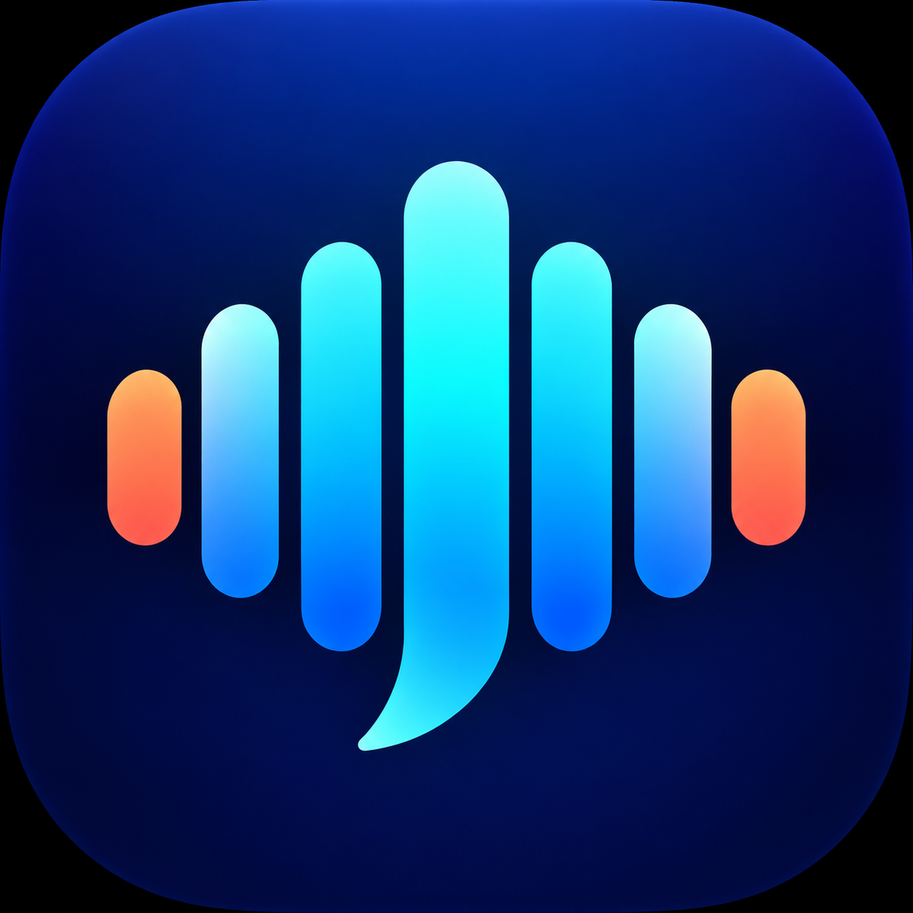

# DictationS

<p align="center">
  
</p>

DictationS is a macOS push-to-talk dictation app. Hold **Fn** while you speak. Release it to transcribe your speech locally and type the result into the focused app.

## Features

- Runs Qwen3-ASR 0.6B or 1.7B with the project's pure-Rust CPU inference crate at [`crates/qwen-asr`](crates/qwen-asr/).
- Shows recording, transcription, model loading, and download progress in a status island at the bottom center of the screen.
- Shows live microphone levels while recording and transcription time after dictation.
- Lets you switch or remove downloaded models from the menu bar without restarting the app.

## Install

Download the [latest DictationS release](https://github.com/titipakorn-th/DictationS/releases/latest) and open its `.dmg` file. Drag `DictationS.app` into the `Applications` shortcut in the disk image.

The current release targets Apple Silicon. This first release is ad hoc signed and not notarized, so macOS may warn before opening it.

To build and install from source, install Rust and the Xcode Command Line Tools, then run:

```sh
./scripts/install-macos.sh
```

The script builds and copies the app to `/Applications/DictationS.app`. Launch it from Applications or run:

```sh
open /Applications/DictationS.app
```

The first model download requires an internet connection.

## Grant permissions

Enable **DictationS** under **System Settings > Privacy & Security > Accessibility**. Restart the app after granting access. DictationS needs Accessibility access to detect **Fn** and type the transcript.

The first time you hold **Fn**, macOS asks for Microphone access. Allow it so DictationS can record speech.

## Choose and manage a model

The default model is Qwen3-ASR 0.6B. DictationS downloads the selected model if its files are missing, at startup or when you select it. The [0.6B](https://huggingface.co/Qwen/Qwen3-ASR-0.6B) and [1.7B](https://huggingface.co/Qwen/Qwen3-ASR-1.7B) checkpoints are hosted by Qwen on Hugging Face.

Open **Speech Model** in the menu bar. Each model has a submenu with **Use this model** and **Remove downloaded model** actions. Your selection is saved for later launches. The menu indicates whether each model is downloaded. The status island shows download progress.

Models are stored under `~/Library/Application Support/DictationS/models/`. DictationS migrates existing data from `~/Library/Application Support/Dictations` on launch and preserves files already in the new location. Removing the selected model unloads it and leaves DictationS open without a model. Choose a model again to download it.

Set `DICTATIONS_MODEL_DIR` to load a ready model from a custom directory. This disables automatic model downloads.

## Audio and privacy

DictationS captures audio while you hold **Fn**. It keeps samples in memory, writes a temporary WAV file for inference, and removes that file after transcription. Speech recognition runs locally on your Mac. The transcript is typed into the app that has focus.

## Build

To build the app bundle without installing it, run:

```sh
./scripts/package-macos.sh
```

The script writes `target/DictationS.app` and includes the icon from `packaging/AppIcon.png` in the bundle as `DictationS.icns`.

To create a compressed disk image, run:

```sh
./scripts/package-dmg.sh 0.1.1
```

The script writes `target/DictationS-<version>.dmg`.
